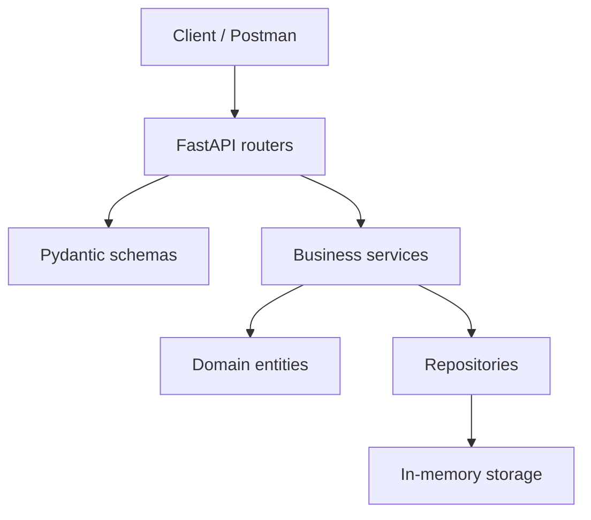

# EcoDrop API 🍃

> A Tech for Good REST API connecting food donors with food banks to reduce food waste before surplus food expires.

**Version:** 0.1.0 · **Status:** Academic backend prototype

## 📌 About The Project

EcoDrop helps supermarkets, restaurants and caterers offer surplus food to local food banks and charities. Donors register food batches with quantities, expiration dates and pickup addresses. Food banks can browse available donations, reserve a batch for pickup and cancel a reservation when necessary.

The project focuses on a REST API and its business rules rather than a graphical user interface. The current implementation uses in-memory storage and is intended for local development and demonstration.

### Key Features

- Register, browse, retrieve, edit and withdraw food donations.
- Filter donations by status and display the soonest-expiring batches first.
- Reserve available, unexpired donations and prevent duplicate claims within the running server process.
- Browse and cancel claims; cancellation releases the associated donation, provided it has not expired.
- Validate request data and return meaningful HTTP error responses.
- Explore and test the API using Swagger UI, Postman and automated tests.

## 🛠️ Tech Stack

| Technology | Purpose |
|---|---|
| Python 3.11+ | Backend programming language |
| FastAPI | REST API and dependency injection |
| Pydantic | Request validation and response schemas |
| Uvicorn | ASGI application server |
| In-memory repositories | Process-local donation and claim storage |
| Pytest / HTTPX2 | Automated tests and HTTP test client |
| Ruff | Linting and formatting |
| OpenAPI / Swagger UI / ReDoc | API specification and interactive documentation |
| Postman | API requests and collection-based testing |
| setuptools | Python packaging and CLI entry point |

## 👥 Team & Roles

| Team member | Role |
|---|---|
| Krystian | Project Manager / Scrum Master |
| Olek | Backend Developer |
| Maciej | Backend Developer |
| Kuba | DevOps / QA Tester |
| Ola | Technical Writer |

## 🚀 Getting Started

### Prerequisites

- Python 3.11 or newer, with pip and venv.
- Git.
- Postman (optional, for collection-based testing).

No database server, Docker installation or API credentials are required for the current local version.

### Installation & Local Setup

1. Clone the repository:

   ```bash
   git clone https://github.com/Ec0DROP/EcoDrop.git
   cd EcoDrop
   ```

2. Create a virtual environment:

   ```bash
   python -m venv .venv
   ```

3. Activate the environment:

   Linux / macOS / WSL:

   ```bash
   source .venv/bin/activate
   ```

   Windows PowerShell:

   ```powershell
   .\.venv\Scripts\Activate.ps1
   ```

4. Install the application and development dependencies:

   ```bash
   python -m pip install -e ".[dev]"
   ```

5. Start the API:

   ```bash
   ecodrop
   ```

   Alternatively:

   ```bash
   python -m ecodrop --host 127.0.0.1 --port 8000
   ```

6. Open [Swagger UI](http://127.0.0.1:8000/docs) or send a GET request to `http://127.0.0.1:8000/donations`. A freshly started server returns an empty JSON array.

### Configuration

The CLI reads the following environment variables. Explicit CLI arguments override the corresponding valid environment settings.

| Variable | Default | CLI option | Accepted values |
|---|---|---|---|
| `ECODROP_ENV` | `development` | `--env` | `development`, `test`, `production` |
| `ECODROP_LOG_LEVEL` | `INFO` | `--log-level` | `DEBUG`, `INFO`, `WARNING`, `ERROR`, `CRITICAL` |
| `ECODROP_HOST` | `127.0.0.1` | `--host` | Non-empty bind address |
| `ECODROP_PORT` | `8000` | `--port` | 1–65535 |

Use `ecodrop --help` to display available options and `ecodrop --version` to display the package version.

## Architecture & Project Structure

EcoDrop follows a layered architecture. FastAPI routers handle HTTP requests, Pydantic schemas define the API contract, services enforce business rules, and repositories manage data access. Domain entities are represented by Python dataclasses and enums. Dependency injection allows repositories and services to be replaced in tests.



```text
EcoDrop/
├── src/ecodrop/
│   ├── __main__.py       # CLI entry point
│   ├── main.py           # FastAPI application and exception handler
│   ├── api/              # Donation and claim routes
│   ├── core/             # Configuration, dependencies and exceptions
│   ├── domain/           # Domain entities and enums
│   ├── repositories/     # In-memory data access
│   ├── schemas/          # Request and response models
│   └── services/         # Business logic
├── tests/                # API and smoke tests
├── docs/
│   ├── api-endpoints.md
│   ├── remote-api-architecture.md
│   └── postman/
│       └── EcoDrop.postman_collection.json
├── ARCHITECTURE.md
├── pyproject.toml
└── README.md
```

## API Documentation

| Resource | Local URL |
|---|---|
| Base URL | http://127.0.0.1:8000 |
| Swagger UI | http://127.0.0.1:8000/docs |
| ReDoc | http://127.0.0.1:8000/redoc |
| OpenAPI JSON | http://127.0.0.1:8000/openapi.json |

### Donation Endpoints

| Method | Endpoint | Description | Success |
|---|---|---|---|
| POST | `/donations` | Register a food batch | 201 |
| GET | `/donations` | List donations; optionally filter by `status` | 200 |
| GET | `/donations/{donation_id}` | Retrieve a donation | 200 |
| PATCH | `/donations/{donation_id}` | Partially update an unclaimed donation | 200 |
| DELETE | `/donations/{donation_id}` | Withdraw an unclaimed donation | 204 |

### Claim Endpoints

| Method | Endpoint | Description | Success |
|---|---|---|---|
| POST | `/claims` | Reserve an available donation | 201 |
| GET | `/claims` | List existing claims, oldest first | 200 |
| GET | `/claims/{claim_id}` | Retrieve a claim | 200 |
| DELETE | `/claims/{claim_id}` | Cancel a claim | 204 |

To browse claimable food, use `GET /donations?status=available`. `GET /claims` returns existing reservations, not available donations.

### Business Rules

- Donation quantities must be positive; supported units are `kg`, `l` and `pcs`.
- Expiration timestamps must include a timezone and be in the future when creating a donation or changing its expiration date.
- Donations have an effective status of `available`, `claimed` or `expired`. Expiration is calculated when an unclaimed donation is read; claimed donations remain claimed until cancellation.
- Claimed donations cannot be edited, withdrawn or claimed again until the claim is cancelled.
- A claim reserves an entire donation batch. Cancelling a claim releases the reservation; an already expired batch is not claimable again unless its expiry is updated.
- Partial updates change only supplied fields; explicit null values are rejected.

### Example Workflow

Use Swagger UI or Postman to send the following requests with `Content-Type: application/json`.

**1. Register a donation — `POST /donations`**

```json
{
  "donor_name": "Green Market",
  "food_name": "Wholegrain bread",
  "quantity": 12.5,
  "unit": "kg",
  "expires_at": "2030-12-01T18:00:00Z",
  "pickup_address": "15 Green Street, Warsaw"
}
```

Use a future expiration date when running this example. The API returns `201 Created` with the generated donation ID and status.

**2. Browse available donations — `GET /donations?status=available`**

**3. Reserve a donation — `POST /claims`**

```json
{
  "donation_id": 1,
  "food_bank_name": "Local Food Bank"
}
```

Replace `1` with the ID returned in step 1. The response contains the generated claim ID, and the donation becomes `claimed`.

**4. Cancel the reservation — `DELETE /claims/{claim_id}`**

Use the claim ID returned in step 3. A successful cancellation returns `204 No Content`.

### Error Handling

| HTTP status | Meaning |
|---|---|
| 400 Bad Request | Business rule violation, such as an expired donation |
| 404 Not Found | Donation or claim does not exist |
| 409 Conflict | Donation has already been claimed |
| 422 Unprocessable Entity | Request validation failed |

Business errors use a consistent JSON structure, for example:

```json
{
  "error": "donation_not_found",
  "detail": "Donation 999 not found"
}
```

FastAPI validation errors use its standard validation response format. The current route declarations do not explicitly document all business error responses in the generated OpenAPI schema; consult the [API endpoint reference](docs/api-endpoints.md) for details.

## Testing & Quality Assurance

### Automated Tests

After installing development dependencies, run from the repository root:

```bash
python -m pytest -q
```

The suite covers donation and claim operations, validation, expiration, missing resources, conflict handling, concurrent claims and CLI configuration. Tests use isolated repositories and a controllable clock.

### Postman Collection

1. Start a fresh local API server.
2. Import [EcoDrop.postman_collection.json](docs/postman/EcoDrop.postman_collection.json) into Postman.
3. Set the collection variable `baseUrl` to `http://127.0.0.1:8000` (or the configured server address).
4. Run the collection in its original order using Collection Runner: Donations, Claims, Cleanup.
5. Review response status codes and test assertions. The collection stores generated IDs in `donationId`, `secondDonationId` and `claimId` for subsequent requests.

### Code Quality

```bash
ruff check .
ruff format --check .
```

## Code Freeze & Peer Review

During Week 5, feature development is frozen and the focus shifts to peer review, quality assurance and final documentation. Review findings should be recorded as GitHub Issues, with diplomatic feedback and references to the relevant review where available. The EcoDrop Board tracks the status of these findings. Proposed improvements are not considered implemented until the corresponding changes have been verified.

See the [repository Issues](https://github.com/Ec0DROP/EcoDrop/issues) for recorded feedback and its current status.

## Current Limitations & Future Improvements

- Data is stored in memory and is lost when the server restarts. Persistent PostgreSQL storage is proposed but not implemented in this version.
- Authentication, user verification and role-based authorization are not implemented. Donor and food bank names are descriptive input fields, not verified identities.
- The API is a local prototype, not a production-ready public service. Storage is process-local and does not provide database transactions across donations and claims.
- Docker packaging, CI/CD and remote deployment are not included in the supplied implementation.
- Potential peer-review improvements include extracting shared service helpers, evaluating `Decimal` for quantities, clarifying cancellation behaviour in code comments and explicitly documenting business error responses in OpenAPI.

## Additional Documentation

| Document | Purpose |
|---|---|
| [API endpoint reference](docs/api-endpoints.md) | Detailed API contract, examples and QA scenarios |
| [Postman collection](docs/postman/EcoDrop.postman_collection.json) | Executable API requests and assertions |
| [Architecture document](ARCHITECTURE.md) | Architectural design and development guidelines, including planned infrastructure |
| [Remote API architecture proposal](docs/remote-api-architecture.md) | Proposed persistence, deployment, authentication and authorization |

The architecture documents include planned components. The installation instructions and implementation summary in this README describe the current local backend rather than those future components.

## License

The package metadata identifies EcoDrop as proprietary. No separate license file is included in the current repository snapshot.
