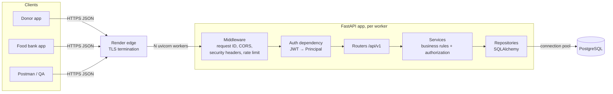
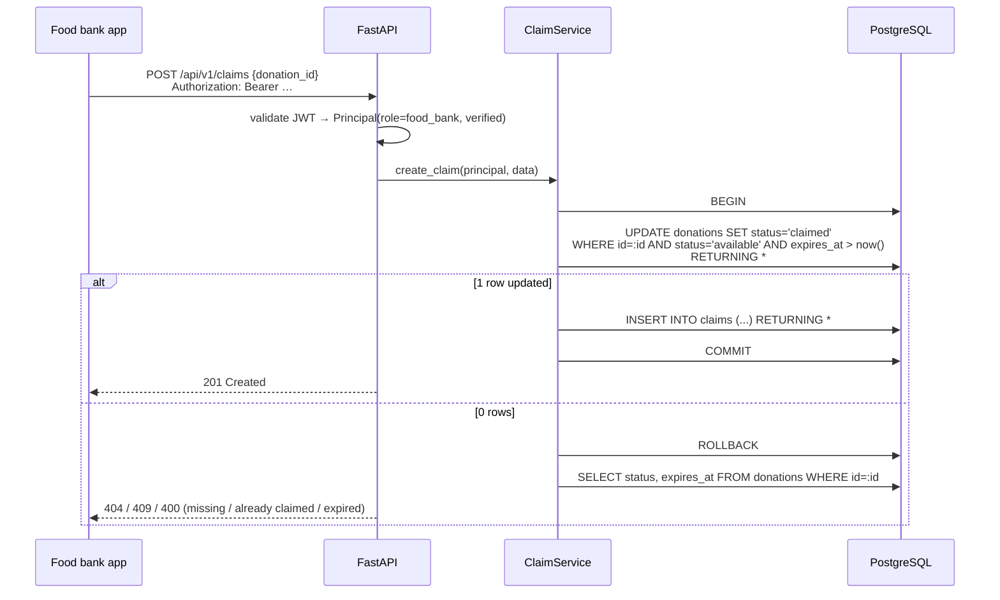

# Remote API architecture: spike findings and proposal

- **Status:** Proposal, awaiting engineering team review
- **Scope:** The EcoDrop HTTP API as of `main` (`d925131`, PR #6) plus the open CRUD PR #7
- **Related:** [`ARCHITECTURE.md`](../ARCHITECTURE.md), [`docs/api-endpoints.md`](api-endpoints.md)

This spike audits the current API, then proposes how the remote API layer should work: the protocol and contract, the data flow, authentication and authorization, and the work needed to get there. Decisions that need the team's agreement are listed in [section 7](#7-decisions-for-the-team).

---

## 1. Summary

- **Keep REST + JSON over HTTPS, with OpenAPI as the contract.** The clients (donor app, food bank app, Postman) need simple CRUD, FastAPI already generates the OpenAPI schema, and nothing in the current requirements needs GraphQL, gRPC or WebSockets.
- **The two blockers before any real deployment are storage and access control.** Data lives in process memory, so it is lost on restart and the app cannot run more than one worker. There is also no authentication: anyone who can reach the API can claim or delete any donation.
- **Authentication:** short-lived JWT access tokens and rotating refresh tokens, issued by the API itself. All token checks go through one FastAPI dependency, so moving to an external identity provider later only changes that dependency.
- **Authorization:** three roles (`donor`, `food_bank`, `admin`), checked together with organization ownership and a `verified` flag for food banks. These checks are enforced in the service layer.
- **Contract hardening:** versioned paths (`/api/v1`), keyset pagination on every list, one error envelope for every error (including `422`), request IDs, and an OpenAPI snapshot test in CI to catch breaking changes.

## 2. Current state

### 2.1 Capabilities

| Area | What exists today |
|---|---|
| Endpoints | `main`: `POST /donations`, `GET /claims` (available donations). PR #7 adds full CRUD: `GET/PATCH/DELETE /donations/{id}`, `GET /donations?status=`, `POST/GET/DELETE /claims`, `GET /claims/{id}` |
| Contract | OpenAPI 3.1 generated by FastAPI; Swagger UI at `/docs`; QA guide and Postman collection in `docs/` |
| Validation | Pydantic schemas: lengths, `quantity > 0`, unit enum, timezone-aware `expires_at`, unknown fields rejected |
| Errors | Business errors return `{"error", "detail"}` with `400/404/409`; validation errors use FastAPI's default `422` body |
| Architecture | Layers as in `ARCHITECTURE.md` (router → schema → service → repository); DI through `Depends`; the clock is injectable for tests |
| Concurrency | PR #7: compare-and-set on donation status, so a donation cannot be claimed twice (covered by a 16-thread test) |
| Quality | `ruff` lint/format; 27 tests on `main`, 61 with PR #7; branch protection requires one approval |
| Runtime | `ecodrop` CLI runs uvicorn; host, port and log level come from `ECODROP_*` env vars or flags, validated at startup |

### 2.2 Constraints and gaps

| # | Finding | Impact | Severity |
|---|---|---|---|
| F1 | **In-memory storage.** Repositories are Python dicts in the process. | Data is lost on every restart or deploy. Running more than one worker or instance splits the data, because each process has its own copy. This blocks horizontal scaling. | High |
| F2 | **No authentication or authorization.** Every endpoint is anonymous. | Anyone can create, edit, delete or claim any donation. The README's "verified food banks" requirement cannot be enforced. | High |
| F3 | **Unbounded list endpoints.** `GET /donations` and `GET /claims` return everything, filtered and sorted in Python on each call. | Measured locally (PR #7, in-memory, TestClient): 100 rows take 30 ms and 20 KiB; 10,000 take 95 ms and 2 MiB; 50,000 take 579 ms and 10 MiB. Cost and payload grow linearly. | Medium now, High at scale |
| F4 | **No API versioning.** Paths are unversioned. | PR #7 already had to change what `GET /claims` means; with no version there is no safe way to evolve the API for existing clients. | Medium |
| F5 | **Two error formats.** Business errors use `{"error","detail"}`; `422` uses FastAPI's `{"detail":[...]}`. | Clients need two parsers; QA has to special-case validation errors. | Low/Medium |
| F6 | **No CI.** `ARCHITECTURE.md` says GitHub Actions gates merges, but there is no `.github/workflows`. | Lint and tests run only on the author's machine; nothing stops a red build being merged. | Medium |
| F7 | **Docs drift.** `ARCHITECTURE.md` describes `app/`, `requirements.txt`, `Dockerfile`, `docker-compose.yml`, Alembic, `.env.example` and `black`; none of these exist. The README tech stack is still placeholders. | New contributors follow instructions that fail. | Low/Medium |
| F8 | **No deployment artefacts** for Render (no Dockerfile, no health endpoint). | Cannot be deployed as planned; the platform cannot health-check the service. | Medium |
| F9 | **No observability.** No request IDs, no structured logs, no health or readiness checks. | Production issues cannot be traced to a request. | Medium |
| F10 | **No edge protections.** No CORS policy, rate limiting, request size limits or security headers. | Needed before browser clients and public exposure; login brute-force would be unthrottled. | Medium (once public) |
| F11 | **Secrets hygiene.** `.env` was committed twice (PR #1 closed; PR #4 merged, removed in #5). Its content was placeholder text, not a credential, so nothing needs rotating. `.gitignore` already ignores `.env`. | Low risk today; the same mistake with a real secret would leak it in git history. | Low |
| F12 | **Swagger UI is always on.** | Fine for dev and QA; for production it is a team decision (section 7). | Low |

### 2.3 Bottlenecks

1. **A single process holds all state** (F1). This is the hard ceiling: throughput cannot grow by adding workers or instances until storage moves out of the process.
2. **Full scans on every list request** (F3). This is O(n) filter + sort + serialize per call, with no pagination or index.
3. **One lock per repository.** Every read and write is serialized. That is harmless at today's volume, but it is the reason the in-memory store must not be "scaled" by adding threads.
4. **Sync endpoints run in a thread pool** (AnyIO's default limit is 40 concurrent sync calls per worker). This is fine for CPU-light CRUD. Once a database adds I/O latency, the per-worker limit is what to watch; the fix is more workers (which needs F1 fixed), not async rewrites.

---

## 3. Proposed architecture

### 3.1 Protocol

| Option | Fit for EcoDrop | Decision |
|---|---|---|
| **REST + JSON over HTTPS** | Resource CRUD (donations, claims, organizations); works from browsers, mobile and Postman; FastAPI generates OpenAPI and Swagger | **Chosen** |
| GraphQL | Helps when many clients need different shapes of deeply nested data; adds schema tooling, query cost limits and N+1 risks | Not now |
| gRPC | Good for internal service-to-service traffic; awkward from browsers and Postman-based QA | Not now |
| WebSockets / SSE | Live "new donation nearby" feeds | Later, if real-time notifications become a requirement; webhooks or SSE first |

Transport is HTTPS only. Render terminates TLS. The app adds HSTS and redirects any plain HTTP.

### 3.2 Components and data flow

**Request lifecycle**

1. The edge terminates TLS and forwards to one of N uvicorn workers.
2. Middleware assigns `X-Request-ID` (or keeps the client's), applies CORS and security headers, and rate-limits sensitive routes.
3. The auth dependency validates the bearer token and builds a `Principal` (user id, organization id, role, verified flag). Missing or invalid tokens return `401`.
4. The router validates the body against the Pydantic schema (`422` on failure) and calls the service.
5. The service enforces business rules and authorization (`403` / `404` / `409` / `400`) inside one database transaction.
6. The repository runs SQL through a pooled session; the service commits or rolls back.
7. The response is serialized through the `*Read` schema, so only contract fields leave the API. Logs carry the request ID.

**Claiming a donation (the one write that must be race-free):**

The conditional `UPDATE` is the database version of the compare-and-set already in PR #7. A `UNIQUE (donation_id)` constraint on active claims is a second guard.

### 3.3 Data model (first PostgreSQL schema)

| Table | Key columns | Notes |
|---|---|---|
| `organizations` | `id`, `name`, `type` (`donor` \| `food_bank`), `verified_at`, `created_at` | Ownership belongs to the organization, so several staff accounts share it |
| `users` | `id`, `organization_id` (nullable for admins), `email` (unique), `password_hash`, `role` (`donor` \| `food_bank` \| `admin`), `is_active`, `created_at` | Argon2id hashes |
| `refresh_tokens` | `id`, `user_id`, `token_hash`, `expires_at`, `revoked_at`, `replaced_by_id` | Only hashes are stored; rotation chain enables reuse detection |
| `donations` | today's fields + `organization_id`, `created_by` | Index `(status, expires_at, id)` serves the default list and keyset pagination |
| `claims` | `id`, `donation_id` (unique), `organization_id`, `created_by`, `claimed_at` | One active claim per donation |

Migrations use Alembic, as `ARCHITECTURE.md` already plans. Timestamps are `timestamptz`, stored in UTC.

### 3.4 Contract conventions

| Topic | Rule |
|---|---|
| Base path | `/api/v1/...`. Breaking changes go to `/api/v2` and the old version gets a `Deprecation` and `Sunset` header for at least one release |
| Resources | Plural nouns; JSON `snake_case`; RFC 3339 UTC timestamps |
| Pagination | Keyset (cursor) on every list: `?limit=` (default 50, max 200) and opaque `?cursor=`. The response is `{"items": [...], "next_cursor": "…" \| null}`. It matches the `(expires_at, id)` sort, so pages stay stable while data changes |
| Filtering | Explicit query params (`status`, later `city`, `expires_before`); unknown values return `422` |
| Errors | One envelope for every error: `{"error": "<code>", "detail": "<message>", "fields": [{"loc": [...], "msg": "..."}], "request_id": "..."}`; `fields` appears only on `422` |
| Idempotency | `POST /donations` and `POST /claims` accept an `Idempotency-Key` header; repeating it within 24 h returns the first result instead of creating a duplicate, which protects mobile clients that retry |
| Concurrency on edits | `PATCH` may send `If-Match: <etag>`; if the donation changed since it was read, the API returns `412` instead of silently overwriting |
| Contract checks | CI exports `openapi.json` and compares it with the committed snapshot. Any change must be committed on purpose, so a breaking change shows up in review |

### 3.5 Performance and scaling

- Move storage to PostgreSQL first (F1). After that, scale by adding uvicorn workers per instance and then instances. Size the connection pool so that `pool size × workers × instances` stays under the database's connection limit.
- Keyset pagination plus the `(status, expires_at, id)` index turns list calls from full scans into index range reads (F3).
- Keep endpoints synchronous with SQLAlchemy and a psycopg 3 pool. That is simpler for the team, and the thread pool is ample for CRUD. Revisit async only if profiling shows threads waiting on I/O.
- No cache layer for now. Donation lists change on every claim, and correctness matters more than shaving milliseconds. Revisit with measurements.
- **Proposed targets, to be validated with a load test once PostgreSQL is in:** p95 under 200 ms for paginated reads and under 300 ms for writes, at 10,000 active donations.

### 3.6 Operations

- `GET /health/live` (process is up) and `GET /health/ready` (database reachable) for Render health checks.
- Structured JSON logs with `request_id`, method, path, status and duration. No personal data or tokens in logs.
- Dockerfile plus `docker-compose.yml` (app + PostgreSQL) for local work, as `ARCHITECTURE.md` already describes.
- CI on every PR: `ruff check`, `ruff format --check`, `pytest`, the OpenAPI snapshot check, and a secret scan (for example gitleaks).

---

## 4. Authentication

**Proposal:** the API issues its own tokens (OAuth2 bearer, JWT access tokens and opaque refresh tokens), behind one dependency that can later accept tokens from an external OpenID Connect provider.

| Element | Design |
|---|---|
| Sign-up | `POST /api/v1/auth/register` creates a user in a new or invited organization. Food bank organizations start **unverified** |
| Login | `POST /api/v1/auth/login` with email + password. Returns `access_token` (JWT, **15 min**) and `refresh_token` (opaque random, **14 days**) |
| Refresh | `POST /api/v1/auth/refresh` **rotates** the refresh token: the old one is revoked and a new one issued. Reusing a revoked token revokes the whole chain, which signals theft |
| Logout | `POST /api/v1/auth/logout` revokes the refresh token. Access tokens expire on their own within 15 min |
| Current user | `GET /api/v1/auth/me` returns the user, organization, role and verified flag |
| Passwords | Argon2id; minimum length 12; checked against a breached-password list if feasible; never logged |
| JWT claims | `sub` (user id), `org` (organization id), `role`, `verified`, `iat`, `exp`, `jti`. Signed with a key from an environment variable. HS256 is enough while only this service verifies tokens; switch to an asymmetric algorithm (ES256 or EdDSA) if other services need to verify |
| Transport | `Authorization: Bearer <token>` only, never in query strings. Browser clients keep the refresh token in an `HttpOnly; Secure; SameSite=Strict` cookie |
| Brute force | Rate limit on `/auth/login` and `/auth/refresh` per IP and per email (for example 5 per minute), and a generic "invalid credentials" message |
| Failure responses | `401` with `WWW-Authenticate: Bearer` and `{"error": "unauthenticated"}`; expired tokens return `{"error": "token_expired"}` so clients know to refresh |

**Alternatives considered**

| Option | Pros | Cons | When to switch |
|---|---|---|---|
| Built-in JWT (chosen) | No external service or cost; easy to test locally; FastAPI has first-class support | We own password storage, reset flows and token rotation | — |
| Managed IdP (Auth0, Clerk, Supabase Auth) | MFA, social login, password reset and security handled for us | Vendor account and cost; harder local testing; another moving part for a small team | If we need MFA or social login, or don't want to own password resets |
| Self-hosted Keycloak | Full OIDC, no vendor lock-in | Heavy to run and operate on Render | Only if several services need SSO |
| Static API keys | Simple | No per-user identity; keys leak and are rarely rotated | Only for machine integrations (below) |

**Later, for machine-to-machine:** if a supermarket's system wants to push donations automatically, issue per-organization **API keys** (shown once, stored hashed, scoped, for example `donations:write`, revocable). They resolve to the same `Principal` as a user token.

## 5. Authorization

Authorization is enforced in the **service layer**, which receives the `Principal`. That keeps the rule from `ARCHITECTURE.md` that routers contain no business logic, and the rules are unit-testable without HTTP. Routers only declare that authentication is required.

Three checks, all of which must pass:

1. **Role:** what kind of actor this is (`donor`, `food_bank`, `admin`).
2. **Ownership:** the resource belongs to the caller's organization.
3. **State:** food bank organizations must be **verified** to claim, and business rules still apply (not expired, not already claimed).

**Endpoint matrix** ("own" = the resource belongs to the caller's organization)

| Endpoint | Anonymous | Donor | Food bank (unverified) | Food bank (verified) | Admin |
|---|---|---|---|---|---|
| `POST /donations` | 401 | ✓ (as own) | 403 | 403 | ✓ |
| `GET /donations` | 401 | own only | available only | available + own claimed | all |
| `GET /donations/{id}` | 401 | own | if available | if available or claimed by own org | ✓ |
| `PATCH /donations/{id}` | 401 | own, unclaimed | 403 | 403 | ✓ |
| `DELETE /donations/{id}` | 401 | own, unclaimed | 403 | 403 | ✓ |
| `POST /claims` | 401 | 403 | 403 `organization_not_verified` | ✓ (as own) | ✓ |
| `GET /claims` | 401 | claims on own donations | own (none yet) | own | all |
| `GET /claims/{id}` | 401 | if on own donation | own | own | ✓ |
| `DELETE /claims/{id}` | 401 | 403 | own | own | ✓ |
| `POST /organizations/{id}/verify` | 401 | 403 | 403 | 403 | ✓ |

- **No existence leaks:** a resource that exists but isn't visible to the caller returns `404`, not `403`, so ids cannot be probed.
- **Audit:** donations and claims record `created_by`. Admin actions (verification, deletions) are logged with the request ID.
- **Open question:** should a donor be able to cancel a claim on their own donation, for example when the food bank never shows up? This is listed in section 7.

## 6. Delivery plan

Each step is one PR, small enough to review and merge in order.

| Step | Work | Unblocks |
|---|---|---|
| 1 | CI workflow (lint, format, tests, OpenAPI snapshot, secret scan); `.env.example`; fix the `ARCHITECTURE.md` and README drift | F6, F7, F11 |
| 2 | Move routes under `/api/v1`; unified error envelope (including `422`); request ID middleware; health endpoints | F4, F5, F9 |
| 3 | PostgreSQL + SQLAlchemy + Alembic; Dockerfile and docker-compose; PostgreSQL repositories behind the current interfaces | F1, F8 |
| 4 | Keyset pagination and indexes on list endpoints | F3 |
| 5 | Organizations, users, auth endpoints, JWT and refresh rotation | F2 (authentication) |
| 6 | Roles, ownership and verification checks in services; admin verify endpoint; endpoint matrix tests | F2 (authorization) |
| 7 | CORS allowlist, rate limiting, security headers, `Idempotency-Key`; first load test against the targets | F10, performance targets |

Each step updates `docs/api-endpoints.md` and the Postman collection, as PR #6 and #7 did.

## 7. Decisions for the team

| # | Decision | Proposed answer |
|---|---|---|
| D1 | Protocol | REST + JSON, OpenAPI contract |
| D2 | Versioning | `/api/v1` path prefix |
| D3 | Identity | Built-in JWT now, OIDC-ready; revisit if MFA or social login is needed |
| D4 | Roles | `donor`, `food_bank`, `admin`; food banks need admin verification to claim |
| D5 | Can a donor cancel a claim on their own donation? | Yes, with a reason, after the pickup window passes (needs a pickup window field) |
| D6 | Swagger UI in production | Off in production, on in development and staging |
| D7 | Sync vs async endpoints | Sync + connection pool; revisit with profiling |
| D8 | Pagination style | Keyset cursor (not offset) |
